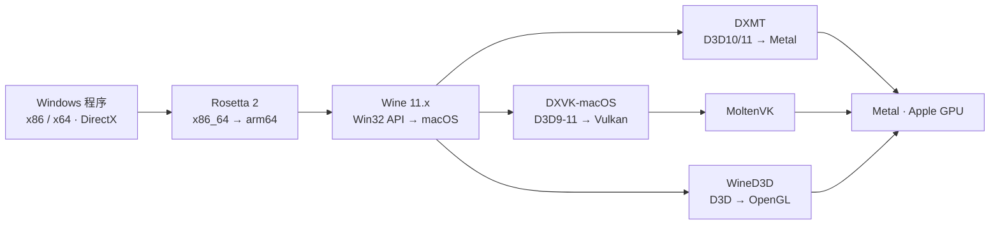

<p align="center">
  
</p>

<h1 align="center">Vermouth</h1>

<p align="center">
  <b>把 Windows 游戏和软件，倒进你的 Apple Silicon Mac。</b><br>
  开源、原生 SwiftUI 的 Windows 转译启动器 · 对标轻量现代版 CrossOver
</p>

<p align="center">
  
  
  
  
  <a href="https://github.com/Goudu666/Vermouth/actions/workflows/ci.yml"></a>
</p>

> **当前版本**：`v0.1.0`（MVP 核心转译闭环：`VermouthCore` 核心库、`vermouth` 命令行工具与原生 SwiftUI `Vermouth.app`）。
> 现状与路线图见 [docs/STATUS.md](./docs/STATUS.md)、[docs/ROADMAP.md](./docs/ROADMAP.md)；架构与契约见 [docs/ARCHITECTURE.md](./docs/ARCHITECTURE.md)、[docs/INTERFACES.md](./docs/INTERFACES.md)。

## 转译链路，一眼看懂

Vermouth 把每个容器背后真实运行的整条链路摊开给你看，界面里显示的命令就是实际执行的命令：



---

## 核心特性（v0.1）

- **环境预检与多源引擎管理**：只读检测 Apple Silicon、macOS 14+、Rosetta 2、Homebrew、Winetricks 与多套本机 Wine 引擎（平等支持新 WoW64 单二进制 `wine-stable` 11.x、`wine@staging`、`Wine Crossover.app` 与自定义引擎目录），自动识别 32/64 位、`MSync` 与 `WINEDLLPATH_PREPEND` 能力。
- **容器全生命周期管理**：每个容器由独立 `WINEPREFIX` 与人类可读 `bottle.json` 组成，支持新建、重命名、APFS 克隆、外部前缀安全导入（防误删隔离保护）、Windows 目标版本切换、Retina DPI 缩放、虚拟桌面、Apple **Metal Performance HUD** 开关与**中文环境（UTF-8 Locale + CJK 字体链接）一键补全**。
- **容器级图形转译层切换**：支持按容器无损切换 `WineD3D`（DX7/8/9 兜底）、`DXVK-macOS`（Vulkan → MoltenVK → Metal）与 `DXMT`（DX10/11 → Metal 直译）；支持官方 GitHub Releases 在线拉取与本地归档导入，自动识别 `WINEDLLPATH_PREPEND` 零拷贝模式与容器 DLL 备份覆盖/回滚模式。
- **程序安装、扫描与社区配方**：支持拖入或选择 `.exe` / `.msi` 安装器直接安装，自动解析 Start Menu / Desktop `.lnk` 快捷方式与 `Program Files` 可执行程序；内置 `GTA: San Andreas (PC 1.0)`（32 位 DX9 标杆）与 `DirectX 11 Modern 64-bit Default` 配方，支持社区 `.recipe.json` 导入与脱敏导出。
- **实时流式日志与崩溃诊断**：捕获 Wine 输出流并做规则化故障翻译（缺失 DLL 运行库映射、`com.apple.quarantine` 拦截、32/64 位架构不匹配、图形后端初始化失败、`wineserver` MSync 冲突），提供一键修复快捷动作。
- **程序卡片墙与真实图标**：自研 Clean-Room PE 资源解析器直接从 `.exe` 提取图标（`RT_GROUP_ICON` → `.ico`），程序库像游戏库一样一目了然；也可用 `vermouth icon` 命令导出。
- **运行库可视化安装器**：勾选 VC++、D3DX9、D3DCompiler、.NET、字体等常用组件，一键用容器同源环境调用 `winetricks`；诊断出缺失 DLL 时可直接「一键安装」。
- **日志分级着色**：自动识别 Wine `err` / `warn` / `fixme` / `trace` 级别与调试通道，默认隐藏刷屏噪音，错误行高亮。
- **高级 DLL 覆写与原子快照**：可视化管理 `WINEDLLOVERRIDES`（内置 `dinput8` / `vorbisfile` / `winhttp` / `version` 等 Mod 钩子预设，自动检测 DXMT `builtin` 覆写冲突），并提供带 SHA-256 完整性校验的存档/配置目录时间戳快照与安全原子回滚。

---

## 下载安装

不想自己编译的话，直接下载 CI 打好的 `Vermouth.app`（Apple Silicon，release 构建）：

| 版本 | 下载 | 说明 |
|---|---|---|
| 正式版 | [最新 Release](https://github.com/Goudu666/Vermouth/releases/latest) | 推送 `v*` 标签时发布 |
| 每日构建 | [`nightly` 预发布](https://github.com/Goudu666/Vermouth/releases/tag/nightly) · [直接下载 zip](https://github.com/Goudu666/Vermouth/releases/download/nightly/Vermouth-macos-arm64.zip) | `main` 每次更新自动重建 |
| PR 预览 | Actions 里 [Package 工作流](https://github.com/Goudu666/Vermouth/actions/workflows/package.yml) 对应运行页底部的 **Artifacts** | 需登录 GitHub；下载后要**解压两次**（外层是 GitHub 打的包），保留 14 天 |

解压得到 `Vermouth.app`，拖进「应用程序」。

**首次打开（未经 Apple 公证）**：Vermouth 只做了 ad-hoc 签名，没有付费开发者证书，macOS 会拦截。任选一种方式放行：

- **图形界面**：先双击一次（会被拦下）→ 打开「系统设置 → 隐私与安全性」，在底部点「仍要打开」。macOS 14 也可以在 Finder 里**右键 → 打开**。
- **终端**（一条命令，最省事）：
  ```bash
  xattr -dr com.apple.quarantine /Applications/Vermouth.app
  ```

想核对文件完整性：Release 里附带 `Vermouth-macos-arm64.zip.sha256`，用 `shasum -a 256 -c Vermouth-macos-arm64.zip.sha256` 校验。

---

## 环境要求

- **操作系统**：Apple Silicon Mac（推荐 macOS 14 Sonoma 及以上；实测兼容 macOS 15 Sequoia / macOS 26）
- **构建工具**：仅需 **Apple Command Line Tools**（Swift 6 / SwiftPM，**无需安装 15GB 完整 Xcode**）
- **运行依赖**：
  1. Rosetta 2：`softwareupdate --install-rosetta --agree-to-license`
  2. 开源 Wine 引擎（推荐通过 Homebrew 安装）：
     ```bash
     brew install --cask gcenx/wine/wine-stable
     xattr -dr com.apple.quarantine "/Applications/Wine Stable.app"
     ```
     *新版 Homebrew 已移除 `--no-quarantine` 参数，所以改为安装后再用 `xattr` 去掉隔离属性；不去掉的话 Wine 启动时会被 Gatekeeper 拦下。*
     *（同时兼容本机已有的 `Wine Staging.app`、`Wine Crossover.app` 或任意自定义 Wine 目录）*

---

## 快速构建与打包（无需 Xcode）

```bash
# 1. 编译核心库、CLI 与原生 SwiftUI 应用
swift build -c release

# 2. 运行全套单元测试
swift test --parallel

# 3. 打包签名原生 Vermouth.app（输出至 dist/Vermouth.app）
./Scripts/bundle-app.sh --configuration release --output dist

# 4. 启动应用
open dist/Vermouth.app
```

---

## 命令行工具（`vermouth`）速览

`vermouth` CLI 与图形界面共享同一套 `VermouthCore`，所有查询命令均支持 `--json` 输出：

```bash
# 环境预检与引擎查看
swift run vermouth preflight
swift run vermouth engine list

# 创建容器、补全中文环境并应用配方
swift run vermouth bottle create "MyGames" --win win10 --graphics dxmt --sync msync
swift run vermouth bottle chinese-fix "MyGames"
swift run vermouth recipe list
swift run vermouth recipe apply "MyGames" dx11-modern-default

# 预览完整透明启动命令（Dry Run）或直接运行 .exe / .msi
swift run vermouth run "MyGames" ~/Downloads/Setup.msi --dry-run
swift run vermouth run "MyGames" "C:\Program Files\MyGame\Game.exe"

# 扫描已装程序、创建存档快照与日志诊断
swift run vermouth scan "MyGames"
swift run vermouth snapshot create "MyGames" "drive_c/users/crossover/Documents" --label "装Mod前备份"
swift run vermouth diagnose /path/to/wine.log

# 从 .exe 中提取图标
swift run vermouth icon ~/Games/Game.exe --output Game.ico
```

---

## 参与开发（人类与 AI Agent）

本项目由人类开发者与多个 AI 编码 Agent（Google Antigravity、Claude Code）协作开发：

- [`AGENTS.md`](./AGENTS.md) 是所有 Agent 共享的唯一规则源，`CLAUDE.md` / `GEMINI.md` 由 `Scripts/sync-agent-docs.sh` 自动生成，CI 校验同步。
- [`docs/HANDOFF.md`](./docs/HANDOFF.md) 是接力棒快照，[`docs/WORKLOG.md`](./docs/WORKLOG.md) 是工作日志，[`docs/LESSONS_LEARNED.md`](./docs/LESSONS_LEARNED.md) 沉淀踩坑约束。
- Linux 云端开发：`sudo ./Scripts/setup-cloud-linux.sh` 安装 Swift 6.3.3 后即可编译、测试 Core 与 CLI。

---

## 合规声明

Vermouth 仅作为开源编排与管理外壳，**绝不打包或分发**任何游戏本体、商业软件、商业版 Wine 或 Apple 专有组件（如 `D3DMetal` / Game Porting Toolkit 二进制），亦不提供任何绕过在线反作弊系统（EAC / BattlEye / Vanguard 等）的功能。

---

## 许可证

本项目基于 [MIT License](./LICENSE) 开源。
