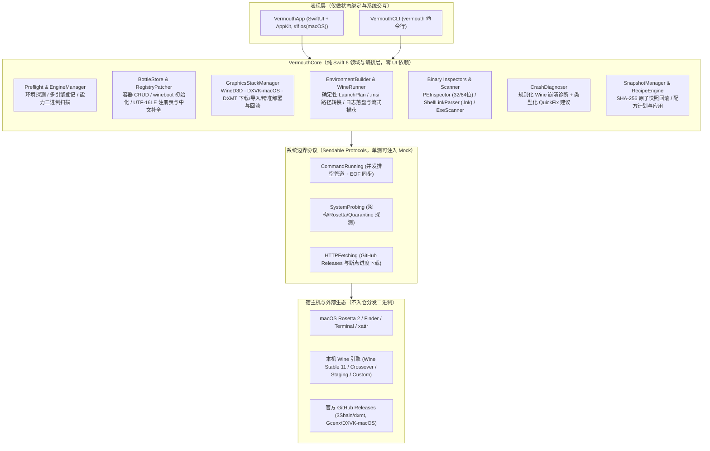

# Vermouth 整体架构与技术栈设计（Architecture Design）

> **状态**：Phase 0 架构定型稿（已通过 Phase 0 对抗审查修订，待用户确认后进入 Round 1）  
> **对应需求**：[PRD.md](../PRD.md) v1.1  
> **许可证边界**：本项目采用 **MIT License**。对所有社区成熟项目（Whisky、Highball、Sikarugir、Barrel 等）**仅借鉴架构思想与 macOS/Wine 领域实践，严格执行 100% Clean-Room 独立实现，绝不复制任何 GPL/非 MIT 代码**。

---

## 1. 成熟项目调研与可借鉴思路

在定型技术栈与架构前，我们对 Apple Silicon macOS 上已验证的开源 Wine 启动器与图形转译层做了针对性调研：

| 参考项目 | 许可证 | 值得借鉴的核心设计 | Vermouth 规避的坑 / 差异化取舍 |
|---|---|---|---|
| **Whisky / WhiskyKit**（已于 2025.05 归档） | GPL-3.0 | 1. 纯 Swift 核心库（`Kit`）与 SwiftUI 界面彻底解耦<br>2. 纯 Swift 实现 PE 文件头解析（32/64 位判断）与 `.lnk` 快捷方式解析<br>3. 原生 macOS `NavigationSplitView` 交互质感 | Whisky 强绑定单一旧版 Wine（CrossOver 22 / Wine 7.7）导致停更即大面积失效；Vermouth 坚持**引擎彻底解耦**，可自由挂接多套本机/社区 Wine。 |
| **Highball**（2026 活跃） | GPL-3.0 | 1. **纯 SwiftPM 多产物架构**：`Core Library` + `CLI` + `SwiftUI App` 共享同一套核心逻辑<br>2. 每个容器由 `WINEPREFIX` + 人类可读 `bottle.json` 构成<br>3. 严格启用 Swift 并发检查，清晰记录 `wineserver` MSync 冲突教训 | Highball 偏重商店集成（Steam/Epic/GOG）和云端兼容库；Vermouth 聚焦**轻量、透明、通用 Windows 转译与排障 + 轻量 Mod/DLL 覆写**，不引入重型商店耦合。 |
| **Barrel / Sikarugir** | MIT / LGPL | 1. 优先通过 `WINEDLLPATH_PREPEND` 实现图形层零拷贝切换，不污染系统 Wine 目录<br>2. 下载文件自动检测并按需清除 `com.apple.quarantine` 隔离属性<br>3. CLI 与 App 同源，CI 在 `macos` runner 做构建与冒烟测试 | Sikarugir 偏重将单个软件封成独立 `.app` wrapper；Vermouth 主打统一容器管理，独立 `.app` 导出留至 v0.2。 |
| **3Shain/DXMT**（最新 v0.80） | MIT → LGPL | 最新官方 Release 仅发布 `dxmt-v0.80-builtin.tar.gz`（`-Dwine_builtin_dll=true`，含 `x86_64-unix/winemetal.so`、`x86_64-windows/*.dll`、`i386-windows/*.dll`） | **重大踩坑点**：① `builtin` 构建的 DXMT **禁止**设置 `dxgi,d3d11,d3d10core=n,b`（需强制 `=b` 或清除旧注册表 override）；② 包含 Unix 侧 `winemetal.so`，**不能**降级复制到 `drive_c/windows/system32`，必须由支持 `WINEDLLPATH_PREPEND` 的引擎加载，否则应快速报错并提示更换引擎或切 `DXVK`/`WineD3D`。 |
| **Gcenx/DXVK-macOS & homebrew-wine** | Zlib / LGPL | 1. DXVK-macOS 同时提供 `-builtin.tar.gz` 与传统 `x64/x32` `.tar.gz`，且已移除 `d3d9.dll`/`dxgi.dll`（macOS 下 DX9 由 WineD3D 兜底）<br>2. `Gcenx/homebrew-wine` 中 `wine-crossover` Cask 已下线，现主力为支持新 WoW64（单二进制同时跑 32/64 位）的 **`wine-stable` (Wine 11.x)** / `wine@staging` | 引擎探测不能只认 `/Applications/Wine Crossover.app` 和 `wine64`，必须同时兼容新 WoW64 单 `bin/wine`、传统 `wine`/`wine64` 双二进制以及 `Wine Stable.app` / `Wine Staging.app` / `Wine Crossover.app` / 自定义路径；且新 WoW64 **禁止**设置 `WINEARCH=win32`。 |

---

## 2. 技术栈最终选型

| 维度 | 选型方案 | 选型理由 |
|---|---|---|
| **语言与标准** | **Swift 6**（开启 `StrictConcurrency`） | 对齐 PRD 与开发机（`macOS 26.5.1 arm64`, Swift 6.3.3）；零桥接调用 AppKit / SwiftUI / Foundation；值语义 + `Sendable` 保证异步子进程与日志流并发安全。 |
| **构建与打包** | **纯 SwiftPM（`Package.swift`）+ `Scripts/bundle-app.sh`** | 零完整 Xcode 依赖，仅需 Apple Command Line Tools；打包脚本显式生成非沙盒 `Info.plist`（`NSPrincipalClass=NSApplication`、`LSMinimumSystemVersion=14.0`）、将 SwiftPM `*.bundle` 复制进 `Contents/Resources/` 并执行本地 ad-hoc `codesign`。 |
| **依赖策略** | **零第三方依赖**（纯 Foundation / Swift 标准库；纯 Swift Clean-Room SHA-256；SwiftUI / AppKit 仅位于 `VermouthApp`） | 编译极快、零供应链与 GPL 污染风险、且 `VermouthCore` 与 `VermouthCLI` 在 macOS/Linux 双端保持高度可移植。 |
| **产物形态** | **三目标解耦**：<br>1. `VermouthCore`（核心库）<br>2. `VermouthCLI`（可执行命令 `vermouth`）<br>3. `VermouthApp`（macOS 14+ 原生 SwiftUI 应用，在 `Package.swift` 中通过 `#if os(macOS)` 隔离） | 借鉴 Highball/Barrel 最佳实践：所有逻辑下沉到 `VermouthCore`，`VermouthCLI` 使无界面调试、CI 自动化与排障极度方便，`VermouthApp` 保持极薄的声明式 UI 层。 |
| **测试框架** | **Swift `XCTest`** | 在 Swift 6 macOS CI 稳定可靠，原生支持 `async/await` 异步测试与临时目录真实文件 I/O 测试。 |
| **持续集成** | **GitHub Actions `macos-15`（Apple Silicon arm64，原生 Swift 6 + SwiftUI + AppKit + `codesign`）** | 当前云端开发机为 Linux x86_64（无 Swift 工具链且外网仅放行 GitHub），每轮推送开发分支后由 GitHub Actions `macos-15` 真机 runner 执行 `swift build`、`swift test` 与 `Scripts/bundle-app.sh` 全链路验证，再通过 `gh run view` 回收完整编译/测试日志进入复盘。 |

---

## 3. 分层架构设计



### 核心架构原则（不变量）

1. **单一真相与透明命令（`LaunchPlan` 不变量）**  
   所有 Wine 子进程启动（运行 `.exe`/`.msi`、拉起 `winecfg`/`regedit`/`cmd`、`wineboot --init`、导入 `.reg`、打开预注入环境变量的终端）**必须**统一经由 `EnvironmentBuilder` 生成不可变 `LaunchPlan`。UI 里的「查看启动命令」与实际执行的进程完全同源，杜绝 `MSync`/`ESync` 环境变量不一致引发的 `msync_init` 崩溃。
2. **绝不修改系统 Wine 目录 + 图形层精准部署策略**  
   外部 Wine 引擎目录（`/Applications/Wine *.app`、`/opt/homebrew` 等）严格只读。图形层统一存放在应用数据目录 `graphics/` 下，按包格式与引擎能力严格分流：
   - **`wineBuiltin` 包（如 `dxmt-v0.80-builtin.tar.gz`、`dxvk-*-builtin.tar.gz`）**：
     - 仅允许部署到 `engine.capabilities.supportsWineDLLPathPrepend == true` 的引擎：通过 `WINEDLLPATH_PREPEND=<packageRoot>` 零拷贝注入，同时对包内 DLL 显式发出 `=b`（覆盖容器注册表中残留的旧 `n,b` override），绝不污染系统 Wine 目录。
     - 若引擎不支持 `WINEDLLPATH_PREPEND`，**快速失败**（`GraphicsStackError.engineMissingDLLPathPrepend`）并明确引导切换支持该特性的引擎或改用 `DXVK (nativeDLLs)` / `WineD3D`（绝不错误地将 `.so` + builtin DLL 复制进 `system32`）。
   - **`nativeDLLs` 包（如标准版 `dxvk-macOS-async-*.tar.gz` 含 `x64/`、`x32/`）**：
     - 备份原文件后按需复制至 `prefix/drive_c/windows/{system32,syswow64}`，记录精确清单到 `graphics-state.json`，并**仅对包内实际存在的 DLL** 追加 `=n,b` override。
   - **状态对账语义**：`bottle.json` 为期望状态（Desired State），`graphics-state.json` 为落盘状态（Actual On-Disk State）；每次启动前与切换时做对账，删除图形包前校验未被任何容器引用。
3. **确定性引擎能力探测（无副作用）**  
   `EngineManager` 在只读探测引擎时，通过检查目录结构（`bin/wine`、`bin/wine64`、`lib/wine/i386-windows`）与有限范围只读二进制标记扫描（在 `lib/wine/x86_64-unix/ntdll.so` / `bin/wineserver` 中查找 `WINEDLLPATH_PREPEND` 与 `WINEMSYNC` 符号字符串）判定 `isNewWoW64`、`supports32Bit`、`supportsMSync` 与 `supportsWineDLLPathPrepend`。
4. **原子持久化与统一 JSON 编解码（`VermouthJSON`）**  
   全局统一 `VermouthJSON`（ISO-8601 含毫秒精度、`.prettyPrinted`、`.sortedKeys`、`.withoutEscapingSlashes`），所有配置文件均带 `schemaVersion` 并经由同目录临时文件 + 原子替换落盘。
5. **内置资源查找双路径**  
   内置配方（`Recipes/*.recipe.json`）通过 `Package.swift` `.copy("Recipes")` 打包进 `VermouthCore` 资源 Bundle，并由 `VermouthResourceLocator` 依次查找 `Contents/Resources/`（打包后 `.app`）→ `Bundle.module`（`swift test` / `swift run`）→ 源码相对目录，彻底规避非 Xcode 打包后 `Bundle.module` 崩溃问题。

---

## 4. 目录与模块规划

```text
Vermouth/
├── Package.swift                             # Swift 6，macOS 14+，含 Core / CLI / (#if os(macOS) App) / Tests
├── .github/
│   └── workflows/
│       └── ci.yml                            # macos-15 (arm64) 编译 + 单测 + bundle-app.sh 实机验证
├── docs/
│   ├── ARCHITECTURE.md                       # 本文档：架构、技术栈、成熟项目调研
│   ├── INTERFACES.md                         # 核心协议、完整数据模型、JSON Schema、CLI 契约
│   └── LESSONS_LEARNED.md                    # 迭代复盘与教训约束文档（每轮强制更新）
├── Sources/
│   ├── VermouthCore/
│   │   ├── Common/
│   │   │   ├── VermouthPaths.swift           # 应用支持目录（支持 VERMOUTH_HOME 注入）
│   │   │   ├── VermouthJSON.swift            # 统一 ISO-8601(毫秒) + 原子写盘编解码器
│   │   │   ├── PureSHA256.swift              # Clean-Room 纯 Swift SHA-256（零 CryptoKit/平台锁定）
│   │   │   └── ShellQuoting.swift            # POSIX 安全引号转义与 Windows/Unix 路径互转
│   │   ├── Models/
│   │   │   ├── BottleModels.swift
│   │   │   ├── EngineModels.swift
│   │   │   ├── GraphicsModels.swift
│   │   │   ├── LaunchModels.swift
│   │   │   ├── DiagnosticModels.swift
│   │   │   ├── SnapshotModels.swift
│   │   │   └── RecipeModels.swift
│   │   ├── Protocols/
│   │   │   ├── SystemBoundaries.swift        # CommandRunning / SystemProbing / HTTPFetching
│   │   │   └── ServiceProtocols.swift
│   │   ├── Platform/
│   │   │   ├── LiveCommandRunner.swift       # 并发排空 stdout/stderr + EOF 同步 + 按行解码 + 取消终止
│   │   │   ├── LiveSystemProber.swift        # 架构/OS版本/Rosetta2/Brew/Quarantine 真实探测
│   │   │   └── LiveHTTPFetcher.swift         # URLSession 数据与带进度下载（兼容 Linux/macOS）
│   │   ├── Inspection/
│   │   │   ├── PEInspector.swift             # 纯 Swift PE32/PE32+ 头部解析器
│   │   │   └── ShellLinkParser.swift         # 纯 Swift Windows .lnk 快捷方式解析器
│   │   ├── Engines/
│   │   │   └── EngineManager.swift
│   │   ├── Bottles/
│   │   │   ├── BottleStore.swift             # CRUD、克隆、外部 prefix 安全隔离、原子持久化
│   │   │   └── RegistryPatcher.swift         # UTF-16LE BOM .reg 生成（Win版本/DPI/虚拟桌面/CJK字体/恢复删除）
│   │   ├── Graphics/
│   │   │   └── GraphicsStackManager.swift    # DXMT/DXVK 拉取、tar 分类、双模部署与回滚
│   │   ├── Runner/
│   │   │   ├── DllOverrideFormatter.swift    # 规范化拼接、内置预设、DXMT builtin 冲突检测
│   │   │   ├── EnvironmentBuilder.swift      # 确定性 LaunchPlan、.msi 转 Z:\、预注入终端脚本
│   │   │   └── WineRunner.swift              # 进程调度、日志落盘与流式输出、wineboot/wineserver 管理
│   │   ├── Discovery/
│   │   │   └── ExecutableScanner.swift       # .lnk + Program Files 扫描与噪点过滤
│   │   ├── Diagnostics/
│   │   │   └── CrashDiagnoser.swift          # 规则化崩溃诊断 + DiagnosticQuickFix 建议
│   │   ├── Snapshots/
│   │   │   └── SnapshotManager.swift         # SHA-256 校验、防路径穿越、原子替换安全回滚
│   │   ├── Recipes/
│   │   │   ├── RecipeEngine.swift            # 解析、生成 RecipeApplicationPlan、脱敏导出
│   │   │   └── Resources/                    # SwiftPM 打包内置配方
│   │   │       ├── gtasa-pc-1.0.recipe.json
│   │   │       └── dx11-modern-default.recipe.json
│   ├── VermouthCLI/
│   │   └── VermouthCLI.swift
│   └── VermouthApp/                          # #if os(macOS) 原生 SwiftUI + AppKit 界面
│       ├── VermouthApp.swift
│       ├── AppViewModel.swift
│       ├── PreflightSheet.swift
│       ├── BottleDetailView.swift
│       ├── BottleConfigView.swift
│       ├── ConsoleLogView.swift
│       ├── EngineSettingsView.swift
│       └── SnapshotSheet.swift
├── Scripts/
│   └── bundle-app.sh                         # swift build + Info.plist + 资源 Bundle 复制 + ad-hoc codesign
└── Tests/
    └── VermouthCoreTests/
```

---

## 5. 分轮迭代开发与复盘机制（Swarm Workflow）

严格对齐 [PRD.md §7](../PRD.md)（前置无 Xcode 打包冒烟验证）与「每轮复盘测试 + 教训沉淀约束下一轮」机制：

| 轮次 | 核心交付范围 | 验证手段（GitHub Actions `macos-15` arm64） | 复盘产出 |
|---|---|---|---|
| **Round 1（底座 + 打包冒烟前置）** | `Package.swift` + `.github/workflows/ci.yml` + 最小可启动 `VermouthApp` 壳子 + `Scripts/bundle-app.sh`（对齐 PRD §7 前置打包实测！）+ `Common`（Paths/JSON/SHA256/Quoting）+ 全套 `Models` & `Protocols` + `PEInspector` + `ShellLinkParser` + `EngineManager` + `BottleStore` | `swift build` + `swift test` + `Scripts/bundle-app.sh` 产出 `Vermouth.app` 并执行 `codesign --verify` + `plutil -lint` + 对抗代码审查 | 更新 `docs/LESSONS_LEARNED.md`（Round 1 复盘与新约束） |
| **Round 2（核心转译引擎）** | `DllOverrideFormatter`（含预设）+ `EnvironmentBuilder`（含 `.msi` 转换与终端脚本）+ `RegistryPatcher`（UTF-16LE BOM / CJK FontLink / 撤销删除）+ `GraphicsStackManager`（DXMT/DXVK 拉取/导入/精准部署与回滚）+ `LiveCommandRunner` / `LiveSystemProber` / `LiveHTTPFetcher` + `WineRunner` | 全量单测 + 假 Wine/假前缀集成测试 + 管道死锁/EOF 竞态测试 + 对抗审查 | 更新 `docs/LESSONS_LEARNED.md`（Round 2 复盘与新约束） |
| **Round 3（诊断、发现、快照、配方与 CLI）** | `ExecutableScanner` + `CrashDiagnoser`（含 `DiagnosticQuickFix`）+ `SnapshotManager`（SHA-256 + 原子替换回滚）+ `RecipeEngine` + 两个内置标杆配方 + `VermouthCLI` 全命令打通 | 全量单测 + `vermouth` CLI 端到端冒烟（`preflight`/`bottle`/`graphics`/`run --dry-run`/`diagnose`/`snapshot`/`recipe`）+ 对抗审查 | 更新 `docs/LESSONS_LEARNED.md`（Round 3 复盘与新约束） |
| **Round 4（原生 SwiftUI 完整界面与交付）** | 完整 `VermouthApp`（`NavigationSplitView`、`PreflightSheet`、`BottleDetailView`、`BottleConfigView`、`ConsoleLogView`、`EngineSettingsView`、`SnapshotSheet`）+ `README.md` 构建/使用说明 | `macos-15` 全量编译 + 全量单测 + Release 打包 `Vermouth.app` 验证 + 全量复盘 | 更新 `docs/LESSONS_LEARNED.md` + 交付用户本机 `macOS 26.5.1` 实机冒烟手册 |

> **硬性规则**：每轮开工前，所有参与开发的 Agent 必须先读取 [LESSONS_LEARNED.md](./LESSONS_LEARNED.md) 中的有效约束条目；每轮结束必须等待 GitHub Actions `macos-15` 绿灯并完成对抗审查与复盘更新，方可开启下一轮。
